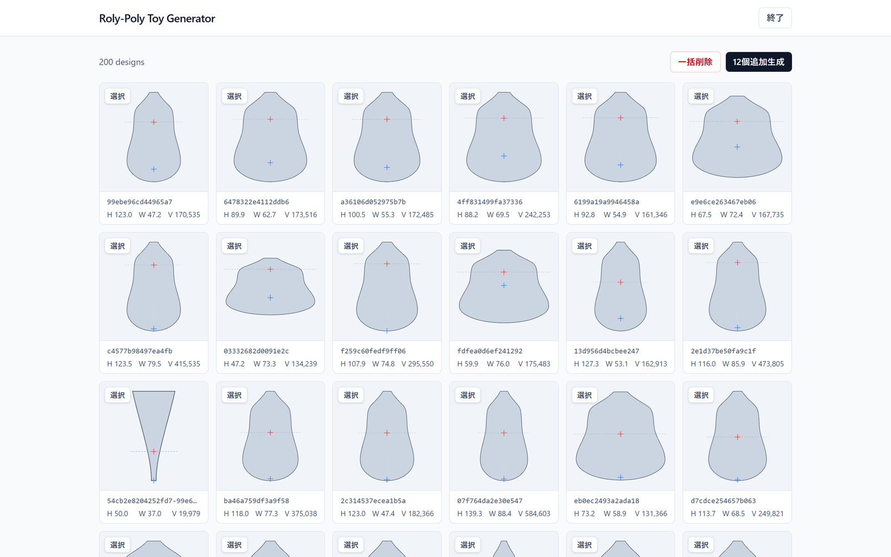

# roly-poly-toy-generator

起き上がりこぼし（倒しても起き上がる回転体）の形を、掛け合わせながら探すローカルの Web アプリです。



作品「[起き上がりはんこ](https://portfolio.m-kw.net/works/okiagari-hanko/)」の制作で、形の候補を探すために作りました。

## できること

- **生成と掛け合わせ**：形をランダムに12個作る。気に入った形を最大4つ選ぶと、それらを掛け合わせて次の12個を作る
- **起き上がる形だけを残す**：75°まで傾けても起き上がる形だけを候補にする
- **断面で比べる**：一覧には断面図と重心の位置を並べる
- **仕上げを試す**：上端を伸ばす量や、上部を斜めに切る高さと角度をスライダーで変え、体積や重心をその場で計算し直す
- **3D 表示と STEP 書き出し**：STEP への変換はブラウザの中で行う（opencascade.js）

## 仕組み

形は縦の軸の周りの回転体として扱い、断面の片側の輪郭 r(z) だけを持ちます。輪郭は「球の一部でできた底」と「5次多項式で細っていく胴」から作ります。この輪郭を遺伝子として持ち、掛け合わせて次の世代を作ります。

起き上がるための条件（底の曲率と重心の高さの関係）は [MATH_ROLY_POLY_TOY.md](MATH_ROLY_POLY_TOY.md) にまとめています。

## 動かす

**必要なもの**：Python 3.11 以上、[uv](https://docs.astral.sh/uv/)、Node.js 20 以上

```bash
git clone https://github.com/morikawa976321/roly-poly-toy-generator.git
cd roly-poly-toy-generator
uv sync
npm install
npm --prefix frontend install
npm run dev
```

`http://localhost:5173/` を開きます。サーバー（`:8000`）と画面が同時に立ち上がります。作った形は `data/app.db`（SQLite）に保存され、外部のサービスは使いません。

Windows 用に、ダブルクリックで動く zip も作れます（`npm run package:windows`）。

## 技術構成

| 層 | 使っているもの |
|---|---|
| サーバー | Python、FastAPI、SQLite、NumPy |
| 画面 | React、TypeScript、Vite、Tailwind CSS |
| 3D | three.js、react-three-fiber |
| CAD 出力 | opencascade.js |
| 輪郭のなめらか化 | Pyodide + SciPy（ブラウザの中で動かす） |

## 状態

作品の制作のために作った試作で、今は開発を止めています。重心の位置と、起き上がるのに必要な重心の高さの表示に、正しくない値が出る不具合が残っています。

## 文書

- [docs/DEVELOPMENT.md](docs/DEVELOPMENT.md) — API、テスト、配布、遺伝子と評価指標の仕様
- [MATH_ROLY_POLY_TOY.md](MATH_ROLY_POLY_TOY.md) — 起き上がりこぼしの物理

## ライセンス

[MIT](LICENSE)
